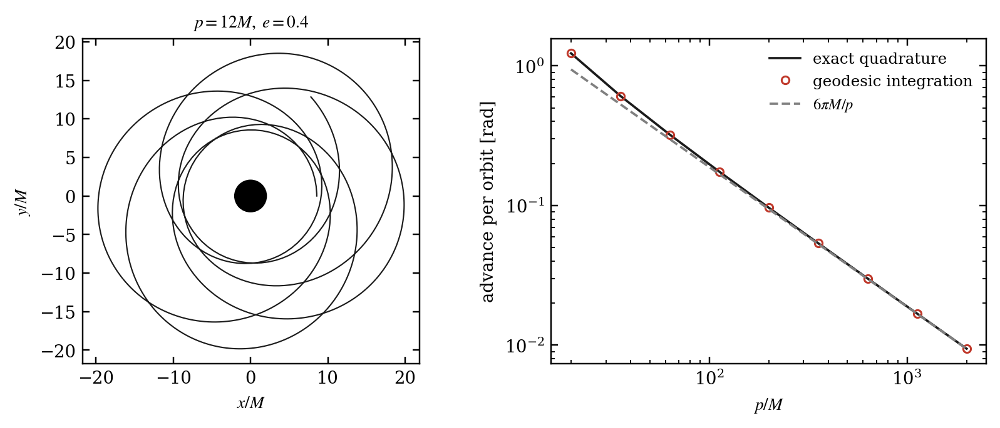
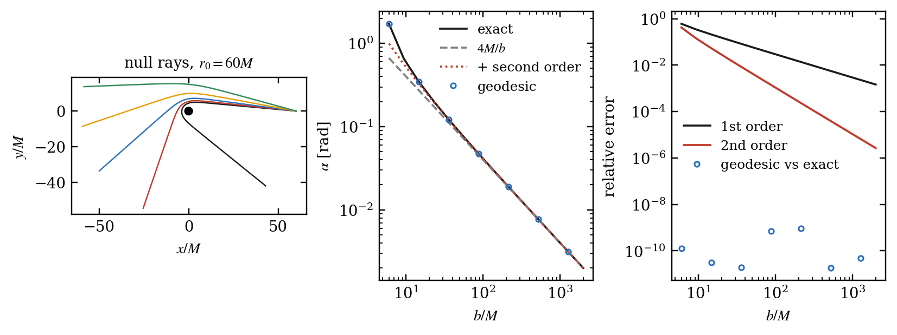
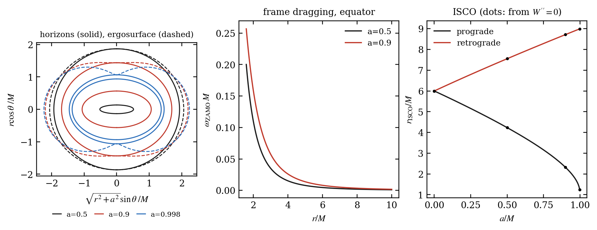
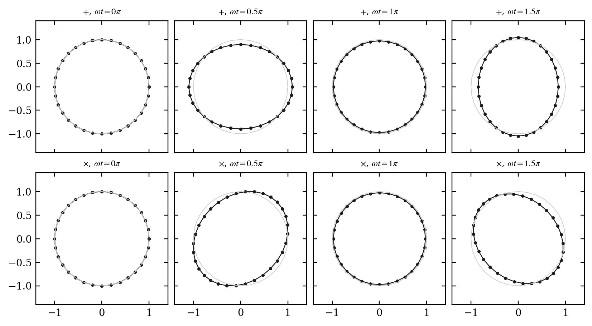
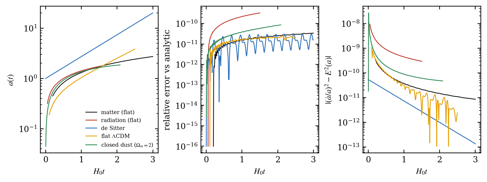
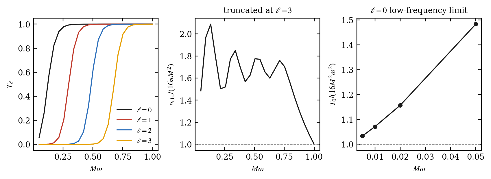
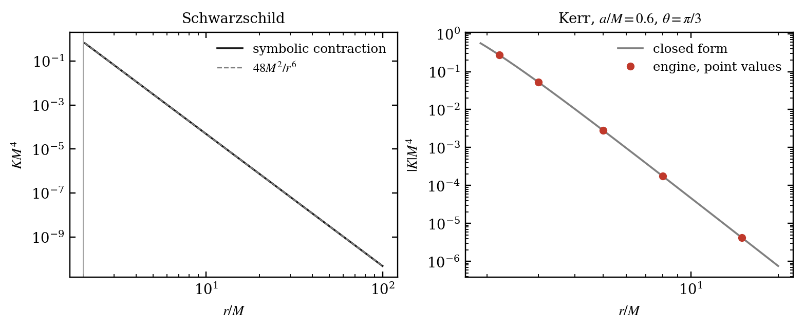
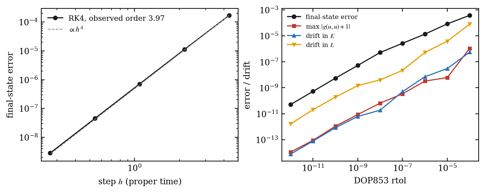

<div align="center">

# General_Relativity Research

**Symbolic and numerical general relativity, implemented from first principles and validated against independent calculations.**


Md Soyeb Hoque, Jadavpur University

</div>

---

## Contents

1. [Overview](#overview)
2. [What has been built](#what-has-been-built)
3. [Mathematical framework](#mathematical-framework)
4. [Validation strategy](#validation-strategy)
5. [Results](#results)
6. [Figures](#figures)
7. [Repository layout](#repository-layout)
8. [Installation and usage](#installation-and-usage)
9. [Experiments](#experiments)
10. [Notebooks](#notebooks)
11. [Documentation](#documentation)
12. [Implementation status and limitations](#implementation-status-and-limitations)
13. [Citing](#citing)

---

## Overview

This repository is a small scientific software system in which the central objects of general relativity are derived, implemented, tested and applied to physical problems. The core calculations are written in this repository using Python, SymPy, NumPy and SciPy. No existing GR package is used for any calculation. SciPy supplies ODE integration and quadrature, and SymPy supplies symbolic algebra and simplification.

It is a research and learning code base. It is not a numerical-relativity code (no 3+1 evolution), and it is not a quantum-gravity code. The last section lists exactly what is complete, partial and not implemented.

## What has been built

| Area | Contents |
|---|---|
| Tensor and metric engine | Symbolic metrics in any dimension, tensors with explicit upper/lower index tracking, raising and lowering, contraction, (anti)symmetrisation, coordinate transformations of tensors and of the (non-tensorial) connection |
| Differential geometry | Levi-Civita connection, covariant derivative of any rank, Riemann, Ricci, Weyl and Einstein tensors, algebraic and differential Bianchi identities, Kretschmann, Euler and Pontryagin densities, Killing vectors, Lie derivatives, differential forms |
| Frame formulation | Orthonormal tetrads, spin connection from Cartan's first structure equation, curvature two-forms from the second, with an exact comparison against the coordinate calculation |
| Dynamics | Geodesic equations (from the connection and independently from the Euler-Lagrange equations), conservation laws, effective potentials, geodesic deviation and tidal tensor, adaptive numerical integrator with event detection and constraint monitoring |
| Spacetimes | Minkowski (several coordinate systems), Schwarzschild (including horizon-regular coordinates), Reissner-Nordstrom, Kerr, FLRW |
| Field equations | Stress-energy tensors, vacuum and Einstein-Maxwell verification, selected variations of the Einstein-Hilbert action, linearised gravity, truncated higher-order perturbation series |
| Observables | Light deflection, periapsis precession, gravitational redshift, Shapiro delay, circular-orbit stability, Newtonian-limit comparisons, gravitational-wave test-particle response |
| Cosmology | Friedmann equations derived from the Einstein tensor, numerical expansion histories compared with five analytic solutions |
| Quantum-gravity connections | Classical scalar field on Schwarzschild (scattering), quadratic gravitational action compared with Fierz-Pauli, an effective-field-theory example, and an explanatory note on string theory |
| Reproducibility | 134 tests, 12 experiments, 12 executed notebooks, derivation documents, benchmarks, CI workflow, generated results summary |

## Mathematical framework

All conventions are fixed once (see [`docs/conventions.md`](docs/conventions.md)) and enforced by tests. The signature is $`(-,+,+,+)`$ and units are $`G=c=1`$ unless stated.

### Connection and curvature

Metric compatibility $`\nabla_\lambda g_{\mu\nu}=0`$ together with zero torsion fixes the Christoffel symbols:

```math
\Gamma^{\rho}{}_{\mu\nu}=\frac12\,g^{\rho\sigma}\left(\partial_\mu g_{\nu\sigma}+\partial_\nu g_{\mu\sigma}-\partial_\sigma g_{\mu\nu}\right).
```

The connection is not a tensor. Under $`x\to x'`$ it transforms with an inhomogeneous term,

```math
\Gamma'^{\alpha}{}_{\beta\gamma}=\frac{\partial x'^{\alpha}}{\partial x^{\rho}}\frac{\partial x^{\mu}}{\partial x'^{\beta}}\frac{\partial x^{\nu}}{\partial x'^{\gamma}}\,\Gamma^{\rho}{}_{\mu\nu}+\frac{\partial x'^{\alpha}}{\partial x^{\rho}}\frac{\partial^{2}x^{\rho}}{\partial x'^{\beta}\,\partial x'^{\gamma}},
```

which is implemented and tested by recovering the polar-coordinate symbols from the Cartesian ones. The Riemann tensor in the declared convention is

```math
R^{\rho}{}_{\sigma\mu\nu}=\partial_\mu\Gamma^{\rho}{}_{\nu\sigma}-\partial_\nu\Gamma^{\rho}{}_{\mu\sigma}+\Gamma^{\rho}{}_{\mu\lambda}\Gamma^{\lambda}{}_{\nu\sigma}-\Gamma^{\rho}{}_{\nu\lambda}\Gamma^{\lambda}{}_{\mu\sigma},
```

with $`R_{\sigma\nu}=R^{\rho}{}_{\sigma\rho\nu}`$, $`R=g^{\sigma\nu}R_{\sigma\nu}`$ and $`G_{\mu\nu}=R_{\mu\nu}-\tfrac12 R\,g_{\mu\nu}`$. The differential Bianchi identity and its contraction are verified directly on explicit metrics:

```math
\nabla_{[\lambda}R_{\rho\sigma]\mu\nu}=0,\qquad \nabla_\mu G^{\mu\nu}=0 .
```

### Action and field equations

The Einstein-Hilbert action with a cosmological constant and matter,

```math
S=\frac{c^{3}}{16\pi G}\int\left(R-2\Lambda\right)\sqrt{-g}\,d^{4}x+S_{\mathrm m},
```

is varied using $`\delta\sqrt{-g}=\tfrac12\sqrt{-g}\,g^{\mu\nu}h_{\mu\nu}`$, $`\delta g^{\mu\nu}=-h^{\mu\nu}`$ and

```math
\delta R=-R^{\mu\nu}h_{\mu\nu}+\nabla_\mu\nabla_\nu h^{\mu\nu}-\Box h .
```

The last two terms form a total divergence $`\sqrt{-g}\,\nabla_\mu V^\mu=\partial_\mu\left(\sqrt{-g}\,V^\mu\right)`$ with $`V^\mu=\nabla_\nu h^{\mu\nu}-\nabla^\mu h`$, and each identity is checked symbolically. Stationarity gives

```math
G_{\mu\nu}+\Lambda g_{\mu\nu}=\frac{8\pi G}{c^{4}}\,T_{\mu\nu}.
```

### Schwarzschild solution and orbits

For the static spherical ansatz $`ds^2=-A(r)\,dt^2+B(r)\,dr^2+r^2d\Omega^2`$ the code finds $`G^{t}{}_{t}=-r^{-2}\,\dfrac{d}{dr}\left[r\left(1-B^{-1}\right)\right]`$, which integrates to the Schwarzschild metric

```math
ds^{2}=-\left(1-\frac{2M}{r}\right)dt^{2}+\left(1-\frac{2M}{r}\right)^{-1}dr^{2}+r^{2}\,d\Omega^{2},
\qquad
K=R_{abcd}R^{abcd}=\frac{48\,M^{2}}{r^{6}} .
```

Equatorial geodesics obey $`\dot r^{2}=E^{2}-V_{\mathrm{eff}}`$ with

```math
V_{\mathrm{eff}}=\left(1-\frac{2M}{r}\right)\left(\kappa+\frac{L^{2}}{r^{2}}\right),
```

where $`\kappa=1`$ for timelike and $`\kappa=0`$ for null curves. Setting $`V'_{\mathrm{eff}}=V''_{\mathrm{eff}}=0`$ symbolically gives the innermost stable circular orbit at $`r=6M`$ with $`E=\sqrt{8/9}`$, and the null case gives the photon sphere at $`r=3M`$.

### Observables

With $`u=1/r`$ the exact deflection of light is

```math
\alpha(b)=2\int_{0}^{u_0}\frac{du}{\sqrt{b^{-2}-u^{2}+2Mu^{3}}}-\pi=\frac{4M}{b}+\frac{15\pi}{4}\frac{M^{2}}{b^{2}}+O\left(b^{-3}\right),
```

and near the critical impact parameter $`b_c=3\sqrt3\,M`$ it diverges logarithmically,

```math
\alpha\to-\ln\left(\frac{b}{b_c}-1\right)+\ln\left[216\left(7-4\sqrt3\right)\right]-\pi .
```

For a bound orbit with semi-latus rectum $`p`$ the periapsis advance per orbit is computed from an exact quadrature and tends to

```math
\Delta\varphi\simeq\frac{6\pi M}{p}\qquad(p\gg M).
```

### Linearised gravity and gravitational waves

For $`g_{\mu\nu}=\eta_{\mu\nu}+h_{\mu\nu}`$ with $`|h_{\mu\nu}|\ll 1`$, the linearised Riemann tensor is invariant under $`h_{\mu\nu}\to h_{\mu\nu}+\partial_\mu\xi_\nu+\partial_\nu\xi_\mu`$, so most components of $`h`$ are gauge. In Lorenz gauge

```math
G^{(1)}_{\mu\nu}=-\frac12\,\Box\,\bar h_{\mu\nu},\qquad \bar h_{\mu\nu}=h_{\mu\nu}-\frac12\,\eta_{\mu\nu}h,
```

and a transverse-traceless plane wave is a vacuum solution only when $`k=\omega`$. Free test particles obey the geodesic-deviation equation

```math
\ddot\xi^{\,i}=\frac12\,\ddot h^{\mathrm{TT}}_{ij}\,\xi^{\,j}.
```

### Cosmology

For FLRW with a perfect fluid the engine returns $`G^{t}{}_{t}=-3\left(\dot a^{2}+k\right)/a^{2}`$ and the Friedmann equations

```math
\left(\frac{\dot a}{a}\right)^{2}+\frac{k}{a^{2}}=\frac{8\pi}{3}\,\rho+\frac{\Lambda}{3},\qquad
\frac{\ddot a}{a}=-\frac{4\pi}{3}\left(\rho+3p\right)+\frac{\Lambda}{3}.
```

Energy conservation $`\dot\rho+3H(\rho+p)=0`$ is not imposed; it is shown to follow from the contracted Bianchi identity.

### Cartan formulation

For an orthonormal coframe $`e^{a}`$ the structure equations are

```math
de^{a}+\omega^{a}{}_{b}\wedge e^{b}=0,\qquad \Omega^{a}{}_{b}=d\omega^{a}{}_{b}+\omega^{a}{}_{c}\wedge\omega^{c}{}_{b}.
```

Writing $`de^{a}=\tfrac12 C^{a}{}_{bc}\,e^{b}\wedge e^{c}`$, the spin connection follows algebraically, without Christoffel symbols:

```math
\omega_{abc}=\frac12\left(C_{abc}+C_{bca}-C_{cab}\right).
```

The resulting curvature is compared exactly with the coordinate Riemann tensor for Schwarzschild, FLRW with spatial curvature, and the unit sphere.

### Scalar field on a curved background

The equation $`\left(\Box-m^{2}-\xi R\right)\phi=0`$ on Schwarzschild, with $`\phi=e^{-i\omega t}P(\theta)\,\psi(r)/r`$, reduces to a one-dimensional scattering problem in the tortoise coordinate $`dr_*=dr/f`$, $`f=1-2M/r`$:

```math
\frac{d^{2}\psi}{dr_*^{2}}+\left(\omega^{2}-V\right)\psi=0,\qquad
V=f\left(\frac{\ell(\ell+1)}{r^{2}}+\frac{2M}{r^{3}}+m^{2}\right).
```

This is a classical field on a fixed background. It is neither a quantised gravitational field nor a statement about Hawking emission.

## Validation strategy

The principle is that a test must not use the same formula to produce both the answer and the expectation.

- **Two independent routes.** Light deflection and periapsis advance are computed by quadrature of the exact orbit equation and by integrating the geodesic equation built from this package's own Christoffel symbols. The geodesic equation itself is also derived separately from the Euler-Lagrange equations of $`\tfrac12 g_{\mu\nu}\dot x^\mu\dot x^\nu`$.
- **Independent closed forms.** The Kerr Kretschmann scalar from a full Riemann contraction is compared with a separately known closed form. Circular-orbit and ISCO formulas from the literature are used as inputs and are checked against the geodesic equation and against a radial function built from the engine's inverse metric.
- **Negative controls.** A wrong connection, a wrongly signed variation, a wrong charge coefficient and a wrong cosmological model must each fail their test, so a passing test carries information.
- **Honest zero-testing.** SymPy cannot always prove an expression is zero. `check_zero` reports whether a conclusion is `exact`, only `numeric` (sampled) evidence, or `nonzero`. Kerr's vacuum property is of the second kind and is documented as such.
- **Convergence and constraints.** Fixed-step RK4 reproduces fourth-order convergence, and every integration reports its normalisation constraint and the drift of its conserved quantities.

## Results

All numbers below are produced by the experiment scripts and stored in [`results/`](results/); the complete table is in [`results/SUMMARY.md`](results/SUMMARY.md).

| Quantity | Measured | Expected behaviour |
|---|---|---|
| Schwarzschild Kretschmann log-log slope | -6.000000 | $`-6`$, from $`K=48M^2/r^6`$ |
| Kerr Kretschmann, engine versus closed form | 4.1e-16 relative | round-off |
| Periapsis advance, geodesic versus quadrature | 4.9e-10 relative | integrator tolerance |
| Light deflection, geodesic versus quadrature | 9.4e-10 relative | finite start radius |
| Residual slope after first and second order deflection | -2.02 and -3.02 | $`-2`$ and $`-3`$ |
| RK4 observed order | 3.97 | 4 |
| Circular-orbit proper period, numeric versus exact | 3.5e-14 absolute | integrator tolerance |
| GW deviation versus exact separation, amplitude slope | 2.00 | 2 |
| Cosmology, worst error against analytic solutions | 3.3e-10 relative | integrator tolerance |
| Kerr ISCO, literature versus effective-function root | 2.8e-14 | root-finder tolerance |
| Scalar scattering flux residual $`1-T-R`$ | 4.4e-09 | round-off and tolerance |
| Low-frequency limit $`T_0/(16M^2\omega^2)`$ at $`M\omega=0.005`$ | 1.0338 | tends to 1 |
| Second-order truncation error slope in $`\epsilon`$ | 4.00 | 4 (see below) |

Several results differ from what one might first assume, and they were found by measuring:

- The truncation error of the second-order plane-wave Einstein tensor scales as $`\epsilon^{4}`$, not $`\epsilon^{3}`$. The map $`\epsilon\to-\epsilon`$ is the relabelling $`x\leftrightarrow y`$, so $`G_{tt}`$ is even in $`\epsilon`$.
- The periapsis advance differs from $`6\pi M/p`$ by a relative $`O(M/p)`$ (measured log-log slope -1.05), not by a relative $`O\left((M/p)^{2}\right)`$.
- All quadratic-curvature corrections ($`R^{2}`$, $`R_{\mu\nu}R^{\mu\nu}`$, $`R_{\mu\nu\rho\sigma}R^{\mu\nu\rho\sigma}`$ and Gauss-Bonnet) leave Schwarzschild a solution in four dimensions. A cubic curvature term does not. This is an exact statement about the reduced equations and says nothing about the size of any coefficient.
- For $`\ell=0`$ the low-frequency absorption cross section tends to the horizon area $`16\pi M^{2}`$.

Timings on a single core, from [`results/benchmarks.json`](results/benchmarks.json): full Schwarzschild geometry 0.81 s, Kretschmann scalar 1.39 s, FLRW geometry 1.13 s, and about 41,213 geodesic right-hand-side evaluations per second.

## Figures

All figures are generated by the scripts in `experiments/` and can be reproduced from source.

<p align="center">
<br>
<em>Precession rosette and periapsis advance versus semi-latus rectum.</em>
</p>

<p align="center">
<br>
<em>Null rays, deflection angle versus impact parameter, and residuals of the weak-field expansions.</em>
</p>

<p align="center">
<br>
<em>Kerr horizons and ergosurface, frame dragging, and ISCO radius versus spin.</em>
</p>

<p align="center">
<br>
<em>A ring of free particles under plus and cross polarised gravitational waves.</em>
</p>

<p align="center">
<br>
<em>Expansion histories, error against analytic solutions, and the Friedmann constraint.</em>
</p>

<p align="center">
<br>
<em>Transmission coefficients of a massless scalar field and the low-frequency horizon-area limit.</em>
</p>

<p align="center">
<br>
<em>Kretschmann scalar for Schwarzschild and for Kerr.</em>
</p>

<p align="center">
<br>
<em>Fourth-order convergence of RK4 and adaptive tolerance versus error, normalisation and conserved-quantity drift.</em>
</p>

## Repository layout

```
src/gr_from_scratch/
  core/              metric, tensors, index operations, coordinate transformations, zero-checking
  geometry/          connection, covariant derivative, curvature tensors, Bianchi identities,
                     invariants, Killing vectors, Lie derivative, forms, tetrads
  dynamics/          geodesics, variational derivation, conservation laws, effective potentials,
                     geodesic deviation, relativistic observables, gravitational-wave test particles
  field_equations/   stress-energy, vacuum equations, action variation, linearised gravity,
                     perturbation series
  spacetimes/        Minkowski, Schwarzschild, Reissner-Nordstrom, Kerr, FLRW
  numerical/         fixed-step RK4, convergence, constraints, boundary data, Friedmann dynamics
  quantum/           scalar field on Schwarzschild, quadratic gravitational action, EFT example
  visualization/     plotting style and helpers
tests/               134 tests (131 fast, 3 marked slow)
experiments/         12 reproducible experiments plus run_all.py and summarize.py
notebooks/           12 executed notebooks and the scripts that build and run them
benchmarks/          timing of the main code paths
docs/                conventions, status, validation, and 11 derivation documents (MkDocs)
figures/  results/   generated figures, JSON results and SUMMARY.md
references/          bibliography
```

## Installation and usage

Python 3.10 or newer is required.

```bash
git clone <repository-url>
cd general-relativity-from-scratch
pip install -e ".[dev]"
```

Run the checks and reproduce the results:

```bash
pytest                           # fast suite, about two minutes on one core
pytest -m slow                   # expensive symbolic checks
ruff check . && ruff format --check .
mypy src
python experiments/run_all.py    # regenerates figures/ and results/
python notebooks/execute_all.py  # executes the 12 notebooks
pip install -e ".[docs]" && mkdocs serve
```

A minimal example:

```python
from gr_from_scratch.spacetimes.schwarzschild import schwarzschild
from gr_from_scratch.field_equations.vacuum_equations import compute_geometry
from gr_from_scratch.geometry.invariants import kretschmann

g = compute_geometry(schwarzschild())
g.einstein.is_zero()  # True: the vacuum equations hold
g.riemann.is_zero()  # False: vacuum but not flat
kretschmann(g.riemann)  # 48*M**2/r**6
```

A numerical geodesic:

```python
import numpy as np
from gr_from_scratch.dynamics import observables as ob

gs = ob.schwarzschild_system()  # M = 1
x0 = np.array([0.0, 20.0, np.pi / 2, 0.0])
u0 = gs.future_directed_u(x0, [0.0, 0.0, 0.02], 1.0)  # timelike, g(u,u) = -1
traj = gs.integrate(x0, u0, 2000.0, rtol=1e-10, atol=1e-12)
abs(traj.constraint).max()  # normalisation drift
```

## Experiments

Each script states its research question, equations, assumptions, parameters, numerical method, tolerances, interpretation and limitations in its header.

| No. | Topic |
|---|---|
| 01 | Curvature invariants of Schwarzschild and Kerr |
| 02 | Effective potentials, photon sphere and ISCO |
| 03 | Periapsis precession: geodesics versus exact quadrature |
| 04 | Light deflection and its weak-field expansion |
| 05 | Integrator convergence and constraint monitoring |
| 06 | Newtonian limit and where it fails |
| 07 | Test particles in a plane gravitational wave |
| 08 | FLRW expansion against analytic solutions |
| 09 | Kerr geometry, frame dragging and ISCO |
| 10 | Massless scalar scattering off a Schwarzschild black hole |
| 11 | First- versus second-order curvature of a plane wave |
| 12 | Tidal tensor from Cartan's equations |

## Notebooks

The twelve notebooks execute from a clean install and each explains its mathematical reasoning before computing: metric construction and coordinate transformations; Christoffel symbols from metric compatibility; Riemann curvature and flat-space validation; Schwarzschild vacuum verification; curvature invariants and singularities; geodesic integration and orbit stability; light deflection and precession; Newtonian-limit comparisons; gravitational-wave perturbations; FLRW cosmology; tetrad-based curvature; and a scalar field on a curved background.

## Documentation

The `docs/` directory is a MkDocs site. Each derivation page states its definitions and assumptions, the argument, the physical meaning, the implementation, the validation and the known limitations.

| Page | Topic |
|---|---|
| [Conventions](docs/conventions.md) | Signature, curvature sign, index placement, units |
| [Status](docs/status.md) | Complete, partial and planned features |
| [Validation](docs/validation.md) | Measured results |
| [1](docs/derivations/01_connection_and_curvature.md) | Connection, covariant derivative, curvature |
| [2](docs/derivations/02_einstein_hilbert.md) | Einstein-Hilbert action and field equations |
| [3](docs/derivations/03_schwarzschild.md) | Schwarzschild solution, orbits, observables |
| [4](docs/derivations/04_charged_and_rotating.md) | Reissner-Nordstrom and Kerr |
| [5](docs/derivations/05_newtonian_limit.md) | Newtonian limit |
| [6](docs/derivations/06_linearized_gravity_and_gravitational_waves.md) | Linearised gravity, waves, second order |
| [7](docs/derivations/07_flrw_cosmology.md) | FLRW cosmology |
| [8](docs/derivations/08_tetrads_and_cartan.md) | Tetrads and Cartan equations |
| [9](docs/derivations/09_quantum_fields_on_curved_spacetime.md) | Scalar fields on curved spacetime |
| [10](docs/derivations/10_perturbative_gravity_and_eft.md) | Perturbative gravity and EFT |
| [11](docs/derivations/11_string_theory_bridge.md) | String theory (explanatory only) |

## Implementation status and limitations

| Status | Items |
|---|---|
| Complete | Tensor and metric engine; connection and curvature; Bianchi identities; invariants; Lie derivative; geodesics; geodesic deviation; Schwarzschild; Reissner-Nordstrom; Newtonian limit; observables; linearised gravity; FLRW; forms and tetrads |
| Partial | Killing vectors (verification only, no solver); Einstein-Hilbert variation (supplied backgrounds, no boundary term, no general engine); Kerr (vacuum verified numerically at sample points, no symbolic proof); second-order perturbation series (specific families); scalar field (classical scattering only); quadratic gravitational action; EFT (one example) |
| Explanatory only | String theory |
| Planned | Ray tracing and imaging module |
| Not implemented | Graviton quantisation, scattering amplitudes, loop calculations, numerical relativity (3+1 evolution) |

Further limitations: components are stored explicitly, so there is no abstract index algebra; test-particle motion has no self-force, spin or radiation reaction; Birkhoff's theorem is assumed rather than proved; the Gibbons-Hawking-York boundary term is discussed but not implemented.

This repository does not solve quantum gravity.

## Citing

Md Soyeb Hoque, Jadavpur University. See [`CITATION.cff`](CITATION.cff). Licensed under the MIT License, see [`LICENSE`](LICENSE).
